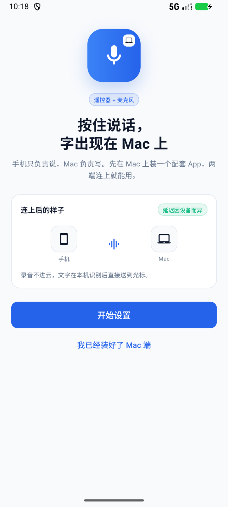
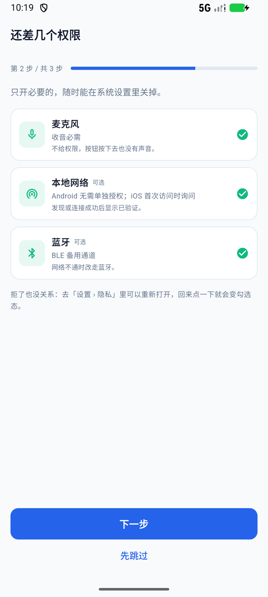
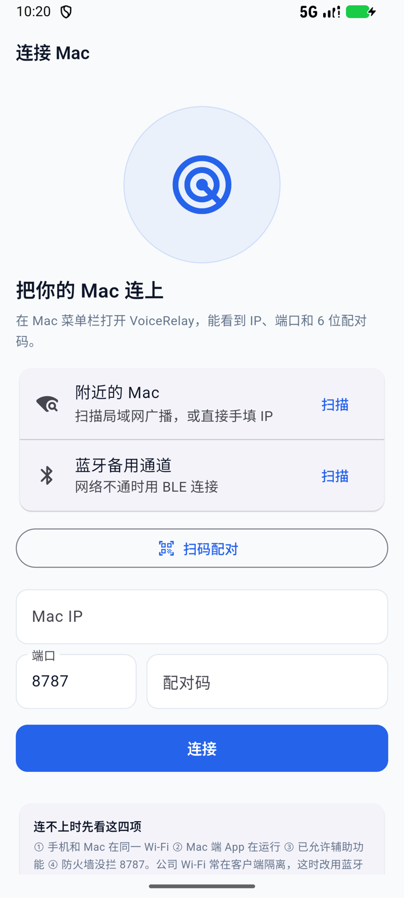
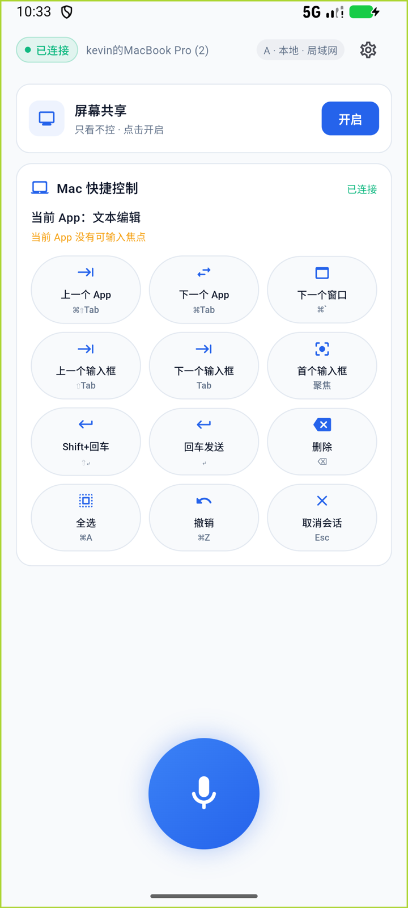

# VoiceRelay · 语音遥控

[简体中文](README.md) · [Install guide](docs/INSTALL.md) · [Contributing](CONTRIBUTING.md)

**Hold your phone, speak, and the text appears in the Mac input field you are already using.** No window switching, no third-party IME, and audio never leaves your LAN.

VoiceRelay is two apps:

- **macOS menu bar app** (SwiftUI): receives audio, transcribes locally with sherpa-onnx + SenseVoice, injects text at the caret, and can switch apps/windows. Screen sharing is available as an experimental read-only feature.
- **Mobile app** (Flutter): hold-to-talk, control keys, status; Bonjour discovery, QR pairing, optional BLE fallback.

## Screenshots

<p align="center">
  
  
  
  
</p>

> Captured on the Android emulator. System bars and fonts vary slightly by device.

> Early but usable. Protocol, authentication, local ASR and text injection are implemented and covered by automated tests. BLE, screen playback and iOS device builds still need real-hardware validation.

## Download

| Platform | Package | Notes |
|---|---|---|
| macOS 13+ | [VoiceRelay-1.0.0-macos-arm64.dmg](https://github.com/KevinSnoopy/voice-relay/releases/latest) | Apple Silicon native (arm64) |
| macOS 13+ | [VoiceRelay-1.0.0.dmg](https://github.com/KevinSnoopy/voice-relay/releases/latest) | Intel (x86_64); also runs on Apple Silicon via Rosetta |
| Android 10+ | [VoiceRelay-1.0.0.apk](https://github.com/KevinSnoopy/voice-relay/releases/latest) | Universal APK, debug-signed, sideload |
| iOS 15+ | Build from source | Requires Xcode and a signing team |

The DMG is **not notarized** by Apple, so the first launch needs right-click → Open, or “Open Anyway” in System Settings → Privacy & Security.

## How it works

1. Install the Mac app, grant Accessibility, download the speech model once (~155 MB, from Settings or the welcome wizard).
2. Install the Android APK, join the same Wi-Fi, scan the QR code shown on the Mac (or enter `IP:8787` + the 6-digit code).
3. Hold the button on the phone and speak; release, and the text appears at the Mac caret.

Pairing uses a one-time code and HKDF-derived long-term keys stored in Keychain/Keystore. Audio frames are authenticated with application-level HMAC; no Bluetooth pairing is required.

## Build

```bash
# macOS
cd mac
./scripts/fetch-deps.sh
swift test
VERSION=1.0.0 ./scripts/package-dmg.sh

# Android
./mobile/scripts/build-apk.sh

# iOS
cd mobile/voicerelay && flutter pub get && open ios/Runner.xcworkspace
```

Requirements: macOS 13+, Xcode 15+, Swift 5.9; Flutter 3.38.x, Android SDK, JDK 17 for the mobile app.

## Status & limitations

- macOS ships as two separate packages, `arm64` (Apple Silicon native) and `x86_64` (Intel), not as a universal binary. The arm64 package links LiveKit's WebRTC build because Google publishes no macOS arm64 WebRTC binary.
- Not notarized, not on any app store.
- LAN-only; no relay, no accounts, no multi-device sync.
- BLE fallback, screen viewing and iOS builds are implemented but not hardware-verified.
- Secure Input fields are refused by design.

## Contributing

Issues, docs fixes, translations, hardware reports and code are all welcome. Start with [CONTRIBUTING.md](CONTRIBUTING.md), or pick a [`good first issue`](https://github.com/KevinSnoopy/voice-relay/labels/good%20first%20issue).

Especially wanted: **iOS device testing**, **BLE testing on more Android vendors**, **Windows/Linux ports**, and **universal (`arm64` + `x86_64`) packaging**.

Security reports: see [SECURITY.md](SECURITY.md). This project follows the [Contributor Covenant 2.1](CODE_OF_CONDUCT.md).

## License

MIT for the code. Third-party libraries and model weights keep their own licenses — see [THIRD_PARTY_NOTICES.md](THIRD_PARTY_NOTICES.md). Model weights are **not** bundled; the app downloads them from the official sherpa-onnx release on first run.
