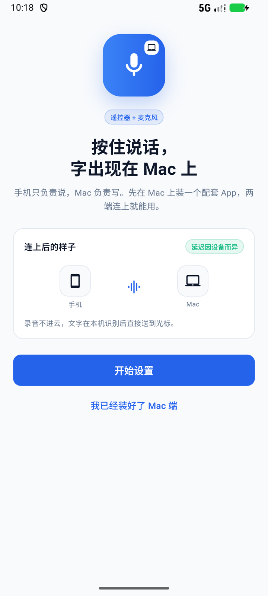
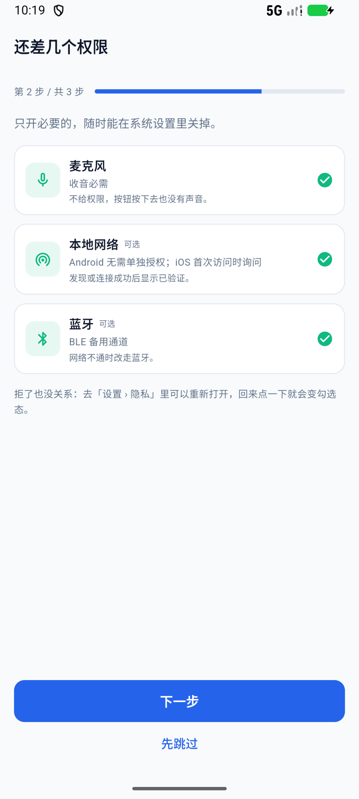
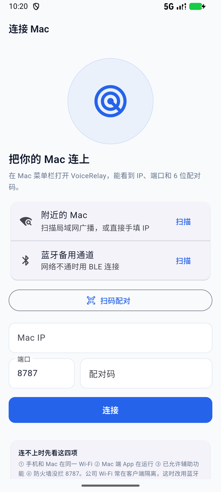
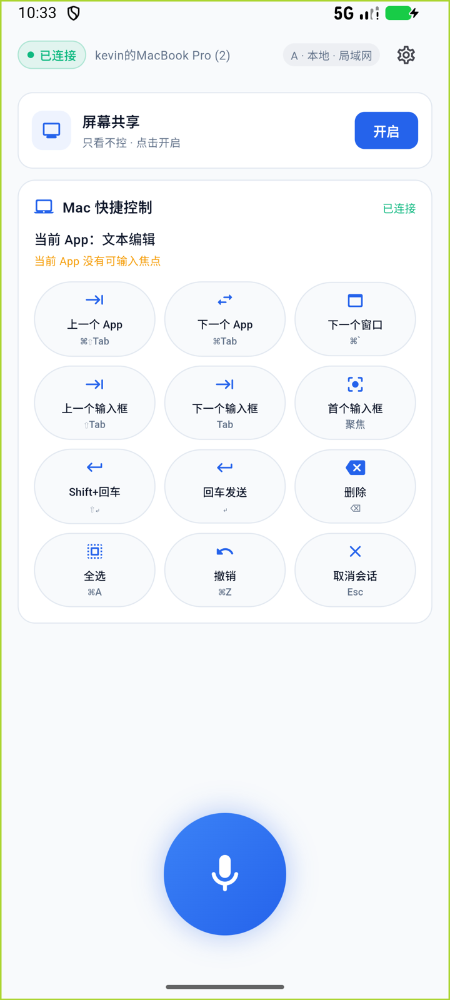

# VoiceRelay · 语音遥控

[English](README.en.md) · [安装说明](docs/INSTALL.md) · [参与贡献](CONTRIBUTING.md) · [更新日志](CHANGELOG.md)

**按住手机说话，文字直接落进 Mac 当前输入框。** 不用切换窗口，不用第三方输入法，音频只在局域网内传输。

VoiceRelay 由两部分组成：

- **Mac 端**（SwiftUI 菜单栏 App）：接收音频、用 sherpa-onnx + SenseVoice 在本机识别、把文字写进当前光标处，还能切 App、切输入框、投屏幕。
- **手机端**（Flutter）：按住说话、发按键、显示状态；支持 Bonjour 自动发现、二维码配对、BLE 兜底。

> 这是一个**早期但真的能用**的版本：Mac 端协议、认证、本机识别、文字注入已跑通并有自动化测试；屏幕共享、BLE、iOS 真机仍在验收中。已知限制见[项目状态](#项目状态)。

## 截图

<p align="center">
  
  
  
  
</p>

> Android 模拟器实拍。不同机型的系统栏、字体与刘海区域会略有差异。

---

## 下载

| 平台 | 安装包 | 说明 |
|---|---|---|
| macOS 13+ | [VoiceRelay-1.0.0.dmg](https://github.com/KevinSnoopy/voice-relay/releases/latest) | Intel 构建；Apple Silicon 可经 Rosetta 运行 |
| Android 10+ | [VoiceRelay-1.0.0.apk](https://github.com/KevinSnoopy/voice-relay/releases/latest) | 通用包，debug 签名，侧载安装 |
| iOS 15+ | 暂无预编译包 | 用 Xcode 从源码构建，见[构建](#从源码构建) |

安装包**未做 Apple 公证**：首次打开需要右键 → 打开，或在“系统设置 › 隐私与安全性”里点“仍要打开”。完整步骤见 [docs/INSTALL.md](docs/INSTALL.md)。

---

## 三步用起来

1. **装 Mac 端**：把 `VoiceRelay.app` 拖进「应用程序」，打开后按向导授予「辅助功能」权限，并点一次「下载语音模型」（约 155 MB，只需一次）。
2. **连手机**：手机装 APK，和 Mac 连同一个 Wi-Fi；在 Mac 弹窗里扫码，或手动填 `IP:8787` + 6 位配对码。
3. **按住说话**：在手机主屏按住按钮说话，松手后文字出现在 Mac 当前光标处。

配对使用一次性确认码 + HKDF 派生长期密钥，密钥分别存在 macOS 钥匙串和手机 Keychain/Keystore；音频帧用应用层 HMAC 认证，不依赖蓝牙配对。

---

## 项目状态

| 能力 | 状态 |
|---|---|
| 协议 / HMAC 认证 / TCP / Bonjour | ✅ 15 个单元测试通过 |
| 本机识别（SenseVoice int8） | ✅ 5.3 s 音频推理约 280–310 ms，中文逐字正确 |
| 文字注入（AX → Unicode → 粘贴） | ✅ 代码完成，以回读证据判定成功；完整注入矩阵待补 |
| 菜单栏 App（设置、权限、二维码、设备吊销） | ✅ 可用 |
| 屏幕共享（只看不控，WebRTC） | 🧪 代码完成，采集/信令/缩略图已验证；手机端视频播放待真机验收 |
| BLE 备用通道 | 🧪 代码完成，未做硬件验收 |
| 后端 B（虚拟声卡 + 第三方输入法） | 🧪 代码完成，未做虚拟声卡验收 |
| Android 手机端 | ✅ 协议/录音/发现/配对/主界面可用；APK 可安装 |
| iOS 手机端 | 🧪 源码完整，未做真机验收 |
| Apple Silicon 原生构建 | ⏳ 尚未支持，欢迎贡献 |

**已知限制**

- 当前 macOS 安装包是 `x86_64`：Intel Mac 原生运行；Apple Silicon 通过 Rosetta 运行，识别速度会受影响。
- 未公证、未上架；安装时需要手动放行。
- 端口固定 `8787`，屏幕共享用 `8788`；同一网络下多台 Mac 需要改端口。
- 只做局域网直连，不做跨互联网中继，不做多设备/账号体系。
- 密码框（Secure Input）会被直接拒绝，避免把口令写进日志或错误的位置。

---

## 架构

```
┌────────────── 手机 (Flutter) ──────────────┐      ┌────────────── Mac (SwiftUI) ──────────────┐
│ 麦克风 16 kHz PCM ──┐                      │      │  TCP 8787 / BLE GATT                      │
│ 按键 / 控制帧 ──────┼── 自定义帧 + HMAC ────┼─────▶│  ├─ 认证（一次性码 + HKDF 长期密钥）       │
│ 状态 / 结果展示 ◀───┘                      │      │  ├─ sherpa-onnx + SenseVoice int8 识别     │
│ WebRTC 接收 ◀──────── 信令 8788 ───────────┼─────▶│  ├─ 注入：AX → Unicode → 粘贴（默认关）    │
└───────────────────────────────────────────┘      │  └─ ScreenCaptureKit → WebRTC 推流         │
                                                   └───────────────────────────────────────────┘
```

| 目录 | 内容 |
|---|---|
| [`mac/`](mac) | SwiftPM 工程：`VoiceRelayCore`（协议/认证/ASR/注入）、菜单栏 App、`voicerelayd`、`vrphone` |
| [`mobile/voicerelay/`](mobile/voicerelay) | Flutter 手机端，含协议、录音、TCP/BLE、发现、扫码、屏幕观看 |
| [`prototype/`](prototype) | 评审用原型（React + 静态 HTML），**演示数据，不是运行状态** |
| [`docs/`](docs) | 架构、协议、UI、权限、识别与注入、验证计划、风险、决策记录 |
| [`tools/icons/`](tools/icons) | 应用图标矢量母版与各平台产物 |

---

## 从源码构建

### macOS

需要 macOS 13+、Xcode 15+（Swift 5.9）。

```bash
git clone https://github.com/KevinSnoopy/voice-relay.git
cd voice-relay/mac

./scripts/fetch-deps.sh          # 下载预编译 sherpa-onnx（约 23 MB）
swift build                      # 或 swift test 跑 15 个单元测试
swift run voicerelayd --pairing-code 123456   # 无界面联调

./scripts/install-app.sh         # 构建并安装到 /Applications
```

打包 DMG：

```bash
VERSION=1.0.0 ./scripts/package-dmg.sh   # 产物：build/VoiceRelay-1.0.0.dmg
```

`package-dmg.sh` 默认 ad-hoc 签名。若你有 Apple Development / Developer ID 证书，可 `CODESIGN_IDENTITY="Developer ID Application: ..."` 覆盖；公证需要额外的 Apple 账号配置。

> 不要直接运行 `build/VoiceRelay.app` 的副本：macOS 的 TCC 权限按路径 + 签名记录，两个副本会被当成两个 App。安装到 `/Applications` 后再授权。

### Android APK

需要 Flutter 3.38.x（见 [`mobile/voicerelay/.fvmrc`](mobile/voicerelay/.fvmrc)）、Android SDK、JDK 17。

```bash
./mobile/scripts/build-apk.sh
# 产物：mobile/voicerelay/build/dist/VoiceRelay-1.0.0.apk
```

当前 release 构建沿用 debug 签名，便于侧载体验；正式分发请按 [`docs/RELEASING.md`](docs/RELEASING.md) 配置自己的 keystore。

### iOS

```bash
cd mobile/voicerelay
flutter pub get
open ios/Runner.xcworkspace   # 选择自己的 Team 后真机运行
```

iOS 需要真机（屏幕观看依赖 WebRTC），并已在 `Info.plist` 中声明麦克风、相机、蓝牙、本地网络权限。

### 手机端检查

```bash
cd mobile/voicerelay
flutter analyze
flutter test
```

---

## 参与贡献

非常欢迎！不管是报 Bug、补文档、翻译、验证硬件，还是改代码，都有用。

- 先读 [CONTRIBUTING.md](CONTRIBUTING.md)（环境、分支、测试、提交规范）。
- 新手可以从 [`good first issue`](https://github.com/KevinSnoopy/voice-relay/labels/good%20first%20issue) 开始。
- 特别需要帮忙的方向：
  - **Apple Silicon 原生构建**（sherpa-onnx arm64 + WebRTC macOS arm64）
  - **iOS 真机与屏幕观看验收**
  - **BLE 硬件验收**（不同 Android 厂商）
  - **Windows/Linux 端**（协议和 Core 是跨平台的，UI 需要新写）
  - 文档英文翻译、界面文案打磨

安全问题请按 [SECURITY.md](SECURITY.md) 私下报告，不要直接开公开 Issue。

本项目遵循 [Contributor Covenant 2.1](CODE_OF_CONDUCT.md)。

---

## 文档

| 文档 | 内容 |
|---|---|
| [01-architecture.md](docs/01-architecture.md) | 架构、模块、数据流、环境基线 |
| [02-protocol.md](docs/02-protocol.md) | 传输、发现、帧格式、端口、BLE 兜底 |
| [03-ui-mobile.md](docs/03-ui-mobile.md) | 手机端 UI 规格 |
| [04-ui-mac.md](docs/04-ui-mac.md) | Mac 端 UI 规格 |
| [05-permissions-onboarding.md](docs/05-permissions-onboarding.md) | 权限清单与引导 |
| [06-asr-and-injection.md](docs/06-asr-and-injection.md) | 识别选型、注入三级降级 |
| [07-validation-plan.md](docs/07-validation-plan.md) | S1–S5 验证与终止条件 |
| [08-risks.md](docs/08-risks.md) | 风险与平台限制 |
| [09-decisions.md](docs/09-decisions.md) | 决策记录 |
| [10-implementation.md](docs/10-implementation.md) | 第一版实现、实测数据、与文档差异 |
| [11-screen-sharing.md](docs/11-screen-sharing.md) | 屏幕共享设计 |
| [INSTALL.md](docs/INSTALL.md) | 安装与首次运行 |
| [RELEASING.md](docs/RELEASING.md) | 打包、签名与发布流程 |

---

## 许可证

代码以 [MIT License](LICENSE) 开源。第三方组件与模型权重遵循各自许可证，详见 [THIRD_PARTY_NOTICES.md](THIRD_PARTY_NOTICES.md)。

Mac 端不内置模型权重：首次运行从 sherpa-onnx 官方 Release 下载 SenseVoice int8，再由你本机加载。
